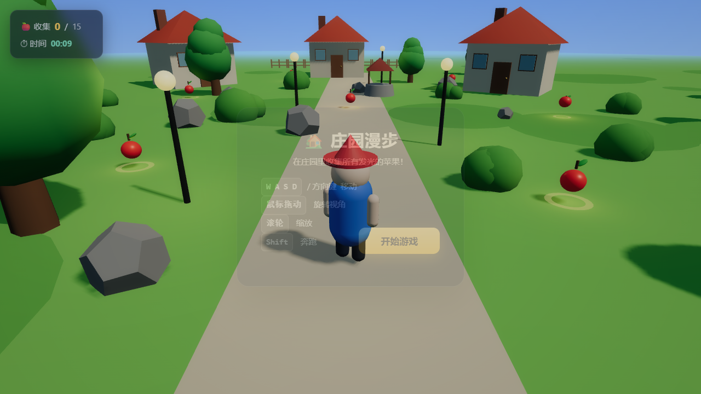

# 🏡 庄园漫步 · Three.js 3D 小游戏

一个基于 **Three.js** 的第三人称 3D 庄园探索小游戏。在庄园里走动，收集所有发光的苹果，比拼用时。



## ✨ 特性

- 🎮 **第三人称角色**：WASD / 方向键移动，Shift 奔跑，带走路摆臂摆腿动画
- 🎥 **环绕相机**：鼠标拖动旋转视角，滚轮缩放，平滑跟随角色
- 🌳 **完整庄园场景**：三栋小屋、水井、路灯、树木、灌木、石头、围栏、石板路
- 🍎 **收集玩法**：15 个发光苹果，靠近即拾取，实时计分 + 计时
- 🌤️ **动态天空**：着色器渐变天空、飘动云朵、日光阴影
- 📦 **零构建**：ES Module + importmap 直接从 CDN 加载 Three.js，打开即玩

## 🚀 运行

任选一种静态服务器方式（浏览器需要通过 http 访问，不能直接双击打开 `index.html`）：

```bash
# 方式一：Python
python -m http.server 4321

# 方式二：Node
npm start        # 使用 npx serve，端口 4321
```

然后浏览器打开：**http://127.0.0.1:4321/**

## 🕹️ 操作

| 按键 | 作用 |
| --- | --- |
| `W A S D` / 方向键 | 移动 |
| `Shift` | 奔跑 |
| 鼠标拖动 | 旋转视角 |
| 滚轮 | 缩放 |

## 📁 项目结构

```
SuperAgentTesting/
├── index.html   # 页面结构、importmap、HUD、遮罩
├── styles.css   # UI 样式、遮罩动画
├── main.js      # Three.js 场景、角色、相机、玩法逻辑
└── README.md
```

## 🛠️ 技术要点

- Three.js r160（ES Module + importmap，无需打包）
- 简单圆形碰撞体 + 世界边界限制
- 相机相对方向移动（移动方向跟随视角）
- `requestAnimationFrame` 主循环 + `Clock` 增量时间

## 调试

- URL 加 `?autostart=1` 可跳过开始界面自动进入游戏（便于截图/测试）。
